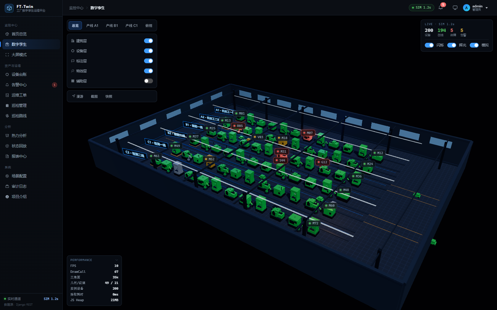

# FT-Twin · 小型工厂数字孪生运维平台

> 让三维场景成为**业务数据的一层视图**，而不是静态演示。
> 完整闭环：设备上报 → 状态渲染 → 告警联动 → 工单闭环 → 数据回流。

200 台设备同屏、约 67 DrawCall、点选耗时 < 2ms。三维不是炫技，它与后端状态强绑定、可双向交互。



---

## 1. 技术栈

| 层 | 选型 |
| --- | --- |
| 前端 | Vue 3 `<script setup>` · Vite 5 · Pinia · vue-router · Element Plus（暗色） · ECharts |
| 三维 | Three.js r170 · InstancedMesh · CSS2DRenderer · UnrealBloomPass · @tweenjs/tween.js |
| 后端 | Django 6.1 · Django REST Framework · Token 认证 · SQLite / MySQL |
| 实时 | MQTT（EMQX，paho-mqtt 发布 / mqtt.js 订阅）· 3s HTTP 轮询兜底 |
| 数据可视化 | 自研网格平面图（SVG）· 热力色阶 · 状态回放时间轴 · 报表 CSV 导出 |

---

## 2. 目录结构

```
smallscalefactory/
├─ frontend/                  # Vue 3 + Three.js
│  ├─ src/
│  │  ├─ three/               # 三维引擎层（与业务解耦）
│  │  │  ├─ core/             # 渲染器 / 相机 / 图层 / 资源释放
│  │  │  ├─ factory/          # 厂房与设备原型（程序化几何，无需 GLB）
│  │  │  ├─ binding/          # 数据 → 实例状态绑定（材质池 / 实例化）
│  │  │  ├─ interaction/      # 拾取、相机飞行、FPS 漫游
│  │  │  ├─ effect/           # 巡检路径动画
│  │  │  └─ TwinScene.js      # 三维门面（唯一对外入口）
│  │  ├─ mock/                # 浏览器内数据层（本地可跑，零后端依赖）
│  │  ├─ api/                 # 统一 API 门面：mock | http 双数据源
│  │  ├─ stores/              # Pinia
│  │  ├─ views/               # 16 个业务页面
│  │  └─ components/          # EChart / StatCard 等
│  └─ scripts/                # Puppeteer 冒烟与截图脚本
├─ backend/                   # Django REST
│  ├─ api/                    # models / serializers / views / services / mqtt
│  │  └─ management/commands/ # seed_demo / simulate_device
│  └─ config/                 # settings / urls
├─ docker-compose.yml         # MySQL + EMQX（可选）
└─ docs/                      # 截图
```

---

## 3. 快速开始

### 3.1 只跑前端（浏览器内模拟数据，30 秒可用）

```bash
cd frontend
npm install
npm run dev          # http://127.0.0.1:5173
```

登录页已预填账号，点击「登 录」即可；也可点「访客一键进入（只读）」。

> mock 模式内置设备模拟器：1.2s 一拍做均值回归随机游走，命中阈值规则后产生告警（同设备同类型 5 分钟去重），偶发故障自动恢复。数据持久化在 localStorage，菜单里可一键重置。

### 3.2 跑完整前后端

```bash
# --- 后端 ---
cd backend
python -m venv ../.venv && ../.venv/Scripts/activate     # Windows
pip install -r requirements.txt
python manage.py migrate
python manage.py seed_demo          # 200 设备 / 70 告警 / 50400 指标 / 6 工单 / 2 巡检线
python manage.py runserver 127.0.0.1:8000

# --- 前端 ---
cd frontend
npm run dev
```

登录后点右上角用户菜单 → **数据源：Django REST**，页面会重载并改用真实接口（切换数据源会清空 token，需重新登录）。

也可用环境变量直接固定：

```bash
# frontend/.env.local
VITE_DATA_SOURCE=http
VITE_API_BASE=/api
```

### 3.3 可选：MySQL + MQTT

```bash
docker compose up -d
# 后端改用 MySQL
DB_ENGINE=mysql DB_HOST=127.0.0.1 python manage.py migrate
```

MQTT 默认关闭（没有 Broker 时浏览器会在控制台打印 WebSocket 失败，干扰观感），
EMQX 起来后这样启用：

```bash
# frontend/.env.local
VITE_MQTT=1
VITE_MQTT_WS_PORT=8083
```

启用后前端连上 `ws://<host>:8083/mqtt`，订阅 `factory/+/+/status`、`factory/+/+/telemetry`、
`factory/alarm/+`，实时通道指示灯显示 `MQTT`；连不上或未启用时自动退回 `POLL 3s` 轮询，
两种模式下页面行为完全一致。后端侧可用 `python manage.py simulate_device --ticks 50` 往 Broker 压数据。

### 3.4 演示账号

| 账号 | 密码 | 角色 | 权限 |
| --- | --- | --- | --- |
| admin | admin123 | 管理员 | 全部（含台账、场景配置、审计） |
| operator | operator123 | 运维人员 | 告警处理、工单流转、巡检执行 |
| demo | demo | 访客 | 只读 |

权限在前端做交互降级，在服务端做真实拦截（`api/permissions.py`）。

---

## 4. 页面一览

| 路由 | 页面 | 要点 |
| --- | --- | --- |
| `/` | 运营总览 | 6 项 KPI、告警趋势、状态环图、SVG 车间平面图（点位可点入三维） |
| `/twin` | 数字孪生 | 视角预设 / 图层开关 / FPS 漫游 / 截图 / 热力 / 巡检路径 / 设备抽屉 |
| `/twin/bigscreen` | 大屏模式 | 三栏布局，告警与工单自动轮播 |
| `/device` | 设备台账 | 车间-产线树、筛选、增删改、CSV 导入导出 |
| `/device/:id` | 设备详情 | 实时曲线（含阈值线）、指标条、保养档案、历史告警、关联工单 |
| `/alarm` | 告警中心 | 多条件筛选、批量确认、规则配置、模拟故障注入 |
| `/workorder` | 运维工单 | 看板拖拽 + 列表双视图，状态机流转，闭环自动关告警并恢复设备 |
| `/inspection` | 巡检管理 | 任务 / 计划 / 点位三视图，异常项提交后自动生成工单 |
| `/inspection/route` | 巡检路线 | 三维路线回放，相机跟随 |
| `/heatmap` | 热力分析 | 温度 / 电流 / 节拍三种色阶，时间轴回看历史帧 |
| `/replay` | 状态回放 | 基于状态流水的 1×/2×/4× 回放 |
| `/report` | 报表中心 | 告警 TOP15、等级分布、时效统计、CSV 导出（带 BOM） |
| `/admin-config` | 场景配置 | 状态配色、图层可见性、背景色、视角预设、快照、GLB 上传位 |
| `/logs` | 审计日志 | 变更前后 diff |
| `/about` | 项目介绍 | 架构分层、关键取舍、3 分钟演示脚本、面试 Q&A |

---

## 5. 后端接口

统一前缀 `/api`，认证 `Authorization: Bearer <token>`（同时兼容 DRF 原生 `Token <token>`）。

| 方法 | 路径 | 说明 |
| --- | --- | --- |
| POST | `/auth/login/` | 登录取 token |
| POST | `/auth/demo/` | 访客一键登录 |
| GET | `/overview/stats/` | 总览 KPI |
| GET | `/overview/trend/?range=24h\|7d\|30d` | 告警趋势分桶（本地时区） |
| GET | `/devices/` `/devices/{id}/` | 台账 CRUD |
| GET | `/devices/tree/` | 车间 → 产线 → 设备树 |
| GET | `/devices/live/` | 实时快照（最新指标 + 计数），轮询兜底 |
| GET | `/devices/{id}/metrics/?key=&range=` | 时序指标 |
| POST | `/devices/{id}/command/` | 下发 start / stop / reset |
| GET | `/devices/status-logs/` | 状态流水（回放数据源） |
| GET/POST | `/alarms/` · `/alarms/{id}/ack/` · `/alarms/{id}/close/` | 告警处理 |
| POST | `/alarms/{id}/inject-fault/` | 模拟故障注入 |
| GET/POST | `/alarm-rules/` | 规则配置（管理员） |
| GET/POST | `/workorders/` · `/workorders/{id}/transition/` | 工单流转 |
| POST | `/inspection/tasks/{id}/submit/` | 提交巡检，异常自动建单 |
| GET | `/energy/summary/?group=line\|area\|device` | 能耗聚合 |
| GET | `/report/alarm/` · `/report/alarm/export/` | 报表与 CSV 导出 |
| GET/PUT | `/scene/config/` | 场景配置（GET 需登录，PUT 需管理员） |
| GET | `/logs/` | 审计日志（管理员） |

工单状态机：`pending → assigned → processing → closed`，非法流转服务端返回 400；关闭工单会连带关闭关联告警并把设备状态恢复为 `normal`。

---

## 6. 三个关键设计

**① 200 台设备为什么只要 67 个 DrawCall**
按设备原型（CNC / 冲床 / 注塑机 / 机械臂 / 传感器 / 检测台 / AGV）各建一个「主体 + 细节」两个 InstancedMesh，200 台设备 → 14 个 DrawCall。状态色走 `instanceColor`，不复制材质；每实例一个 `aFault` 属性，经 `onBeforeCompile` 注入呼吸 + 菲涅尔光晕着色器，故障设备的告警呼吸不额外增加 draw call。告警材质只有在存在故障实例时才启用。

**② 三维是数据的视图，不是独立场景**
`TwinScene` 是唯一门面，业务层只调用 `setData / applyStatus / focusDevice / showRoute`。设备节点命名固定为 `DEV_{code}`，将来换成美术 GLB 只需替换 `assets.js` 的工厂方法，绑定层与业务层零改动。图层用 `THREE.Layers` 分离（建筑 / 设备 / 标签 / 特效 / 辅助），拾取只在 DEVICE 层做，避免拾取穿墙。

**③ 双数据源同构**
`src/api/index.js` 把 mock 与 http 收敛成同一套方法签名，页面永远只调 `api.xxx`。因此这个项目可以「零后端演示」，也可以「真接口联调」，切换只改一个开关。实时通道同样抽象成 `deviceStore.onLive()`：mock 由浏览器模拟器推送，http 由 3s 轮询 `/devices/live/` 推送，视图不关心数据从哪来。

---

## 7. 验证脚本

```bash
cd frontend
node scripts/smoke2.mjs                    # mock 模式逐页截图 + 收集控制台错误
node scripts/shot-http.mjs / /twin /alarm  # http 模式逐页截图（MSYS_NO_PATHCONV=1）
```

后端接口自检：

```bash
cd backend && bash api_tests.sh
```

---

## 8. 已知边界

- 设备模型为程序化几何，无美术资产；`/admin-config` 留了 GLB 上传入口与节点命名校验，接艺术资源时替换 `assets.js` 即可。
- 指标数据落 SQLite 单表，生产应换 InfluxDB / TDengine；`DeviceMetric` 已按 `(device, metric_key, created_at)` 建索引。
- MQTT 通道已打通两端（后端 `api/mqtt.py` + `simulate_device` 命令发布，前端 `src/api/mqtt.js` 订阅）；默认关闭，用 `VITE_MQTT=1` 开启，关闭时走 3s HTTP 轮询，行为一致。
